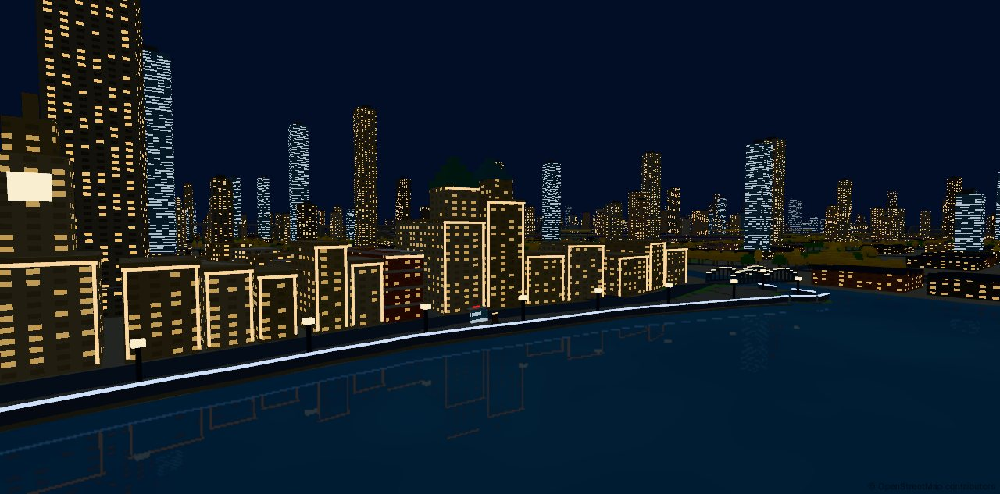
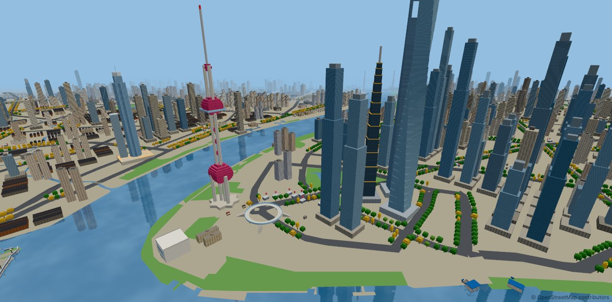
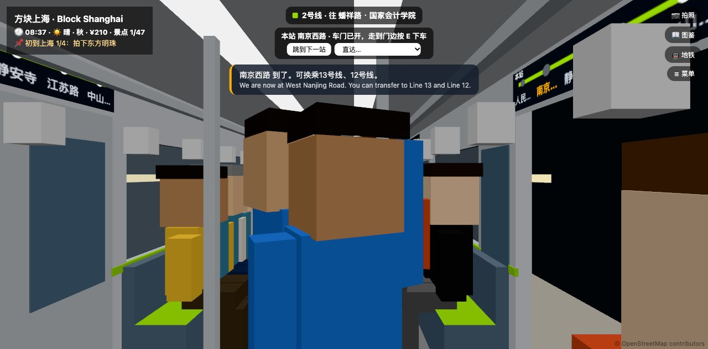
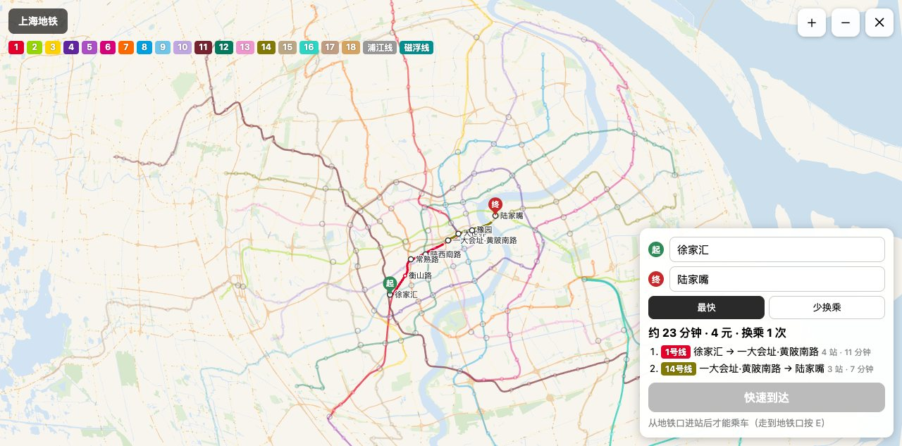

# Block Shanghai · 方块上海

> A blocky open-world Shanghai: stroll through a city with the real shape of Shanghai, photograph and collect its landmarks, and ride the real metro network.

[中文](./README.md) · Play online: <https://block-shanghai.lanyuejin1108.workers.dev/> (desktop or mobile browser; turn your phone sideways)

Built with **Vue 3 + Three.js (WebGPU, falling back to WebGL 2) + TypeScript**, running entirely in the browser. Geography and metro data come from OpenStreetMap and are baked offline into game coordinates. The game has a full English mode: open **☰ Menu → Language**.

**v0.1.0: roadmap phases P1–P6 are done** (frame rates on real phones are still being checked). The design docs in [docs/](./docs/) are in Chinese.

| | |
| --- | --- |
|  |  |
|  |  |

## Highlights

- 🗺️ **The real city layout**: the Huangpu River, Suzhou Creek, the elevated road network and all 16 districts. The city centre is at 200 blocks per km; the outer suburbs are compressed
- 🚇 **The real metro network**: Lines 1–18, the Pujiang Line and the Maglev — 416 stations and 1,484 entrances. Plan routes (fastest / fewest transfers) and pay distance-based fares. Walk into a station, tap in, wait on the platform by the timetable, ride with bilingual announcements, transfer through corridors and leave by the exit you choose. Trains run on the elevated lines above the city
- 📷 **Photograph and collect**: 47 landmarks — the Bund, the Oriental Pearl, Shanghai Tower, Yu Garden, Wukang Mansion, Jing'an Temple, the Lupu Bridge and more. Photos recognise what's in the frame and unlock collection entries; six filters, a selfie view and group photos with passers-by
- 🌿 **Shanghai life**: shikumen lanes and plane-tree streets, passers-by who speak Shanghainese (shown in the original with an English gloss), snack shops and cafés with seasonal food, culture plaques, three Citywalk routes, starter, area, theme and daily quests
- 🚌 **Getting around**: Huangpu ferries and the river cruise, an open-top sightseeing bus, shared bikes (roads only) and metered taxis
- 🎆 **Fireworks**: every evening from 20:30 there are half an hour of fireworks over Wishing Star Lake at the resort (about a minute and a half in real time), ending in a finale; cancelled in rain, snow or typhoons
- 🌦️ **Time and weather**: a day–night cycle with the Bund and Lujiazui lit up in the evening; weather and seasons follow the real date (plum rain, typhoons, snow, autumn leaves)
- 👤 **Your character**: colours, hair, hats and glasses, or upload a 64×64 block-character skin

## Controls

| Action | Keyboard & mouse | Phone |
| --- | --- | --- |
| Move / run / jump | WASD / Shift / Space | Joystick / Run / Jump |
| Look around / zoom | Drag / wheel | Drag on the right half |
| Switch view / map | V / M | View button / tap the minimap |
| Interact (metro, elevators, boats, buses, shops, plaques, chat) | E | On-screen action button |
| Shared bike / taxi | B / T | “🚲 Bike” / “🚕 Taxi” |
| Photo mode | P, Space to shoot, 1–6 filters, V view (incl. selfie) | “📷 Photo”, shutter button |
| Collection, album, metro collection, quests | C | “📖 Collection” |

## Quick start

Requires Node 22.18+, 24 or 26+.

```bash
npm install
npm run dev        # http://localhost:5173
npm test           # unit tests (Vitest)
npm run typecheck  # type check (vue-tsc)
npm run build      # type check + build into dist/, ready for static hosting
```

The baked map data is already in the repository. To rebuild it from fresh OpenStreetMap data, install `osmium-tool` and run `npm run fetch-osm && npm run bake` (see [tools/README.md](./tools/README.md)).

Developer URL parameters: `?debug=1` debug panel, `?quality=low|mid|high`, `?cam=x,y,z&at=x,y,z` free camera, `?time=17:45` game time, `?weather=rain|typhoon|snow|fog|…`, `?season=winter|…`.

## Deployment

`npm run build` produces plain static files with relative paths, so `dist/` can be hosted anywhere, including a sub-path. The live site runs on Cloudflare: `npm run deploy:cloudflare` builds and publishes with `wrangler` (config in `wrangler.jsonc`; run `npx wrangler login` first). As a backup, once the repository is public, every push to `main` is tested, built and published to GitHub Pages (`.github/workflows/pages.yml`). Every push and pull request also runs the type check, tests and build (`.github/workflows/ci.yml`).

## Privacy

The game runs entirely in your browser. It makes no network requests to third parties and collects no data. Saves, settings and the photo album stay in your browser's local storage.

## Known limitations

- Frame rates on real phones are still being checked; the game lowers the graphics quality automatically when it runs slowly
- Landmarks are blocky reinterpretations, not exact replicas; ordinary buildings are generated from district styles and don't match real buildings
- The Shanghainese lines have not been proofread by native speakers, and the English text was translated with AI help and hasn't been reviewed by a native speaker — corrections are welcome
- Needs a browser with WebGL 2 (WebGPU is used when available)

## Contributing

Issues and pull requests are welcome — especially Shanghainese dialogue, English wording, landmark details and performance reports from real devices. See [CONTRIBUTING.md](./CONTRIBUTING.md).

## Data and credits

- Map and metro data © [OpenStreetMap](https://www.openstreetmap.org/copyright) contributors.
- Inspired by [Block Guangzhou (方块羊城)](https://github.com/ns2250225/guangzhou). That project has no license, so only the ideas were borrowed; none of its code is used.

## License

- **Code**: [MIT License](./LICENSE), covering everything in this repository except the data directory below.
- **Map and metro data**: the files in `src/cities/shanghai/data/` are derived from OpenStreetMap and are available under the [Open Database License (ODbL) 1.0](https://opendatacommons.org/licenses/odbl/1-0/), **not** the MIT License. Credit © OpenStreetMap contributors when you use or share them, and share modified data under the ODbL. See [the data README](./src/cities/shanghai/data/README.md) for the source and date. A few coordinates in the code (landmark positions, ferry routes) also come from OpenStreetMap.
- The game always shows the OpenStreetMap credit in the bottom-right corner and on the About page; please keep it when you deploy the game or share screenshots.
